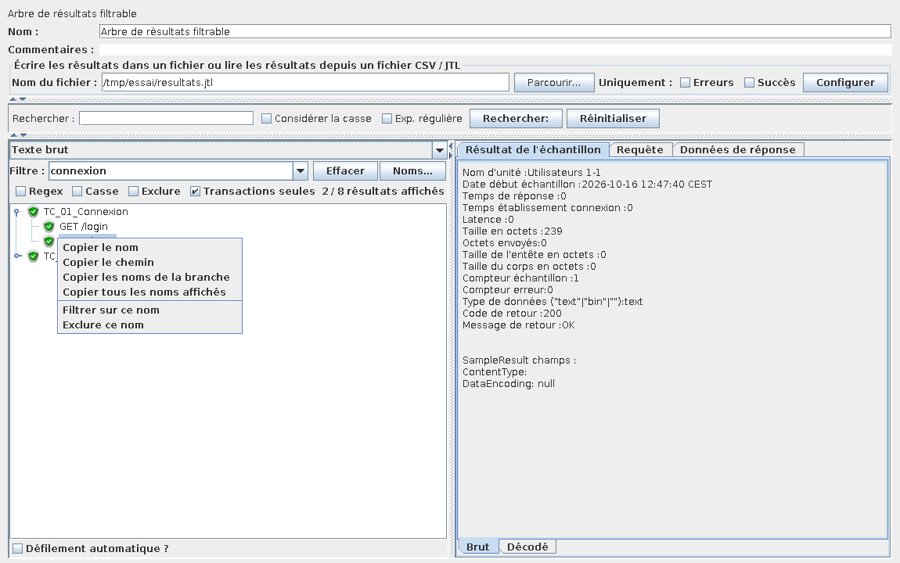
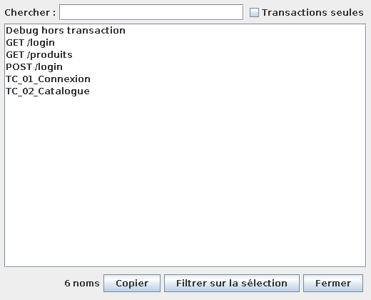

# Arbre de résultats filtrable

Un « View Results Tree » de JMeter, avec en plus :

- **la copie des noms** : clic droit sur un résultat (ou Ctrl+C) ;
- **un filtre sur les noms** des requêtes et des contrôleurs de transaction ;
- **la liste des noms reçus**, pour les retrouver, les copier et filtrer dessus.

Tout le reste (rendus, onglets Requête / Réponse, recherche, lecture d'un
fichier JTL) est celui de l'arbre d'origine, réutilisé tel quel.

## Installation

```bash
mvn package            # depuis la racine du projet
cp arbre-resultats-filtrable/target/arbre-resultats-filtrable-*.jar $JMETER_HOME/lib/ext/
```

Après redémarrage de JMeter : *Ajouter > Récepteur > Arbre de résultats
filtrable*.

## Utilisation



### Copier

Clic droit sur un nœud de l'arbre :

| Entrée | Ce qui est copié |
|---|---|
| Copier le nom | le nom du nœud (`POST /login`) |
| Copier le chemin | le nom précédé de ses parents (`TC_01_Connexion > POST /login`) |
| Copier les noms de la branche | le nœud et tous ses descendants, un nom par ligne |
| Copier tous les noms affichés | tous les résultats visibles, un nom par ligne, sans doublon |

**Ctrl+C** (Cmd+C sur Mac) copie le nom du nœud sélectionné.

### Filtrer

Le champ **Filtre** s'applique en cours de frappe. Sa flèche déroule les noms
déjà reçus.

- Sans option, il garde les résultats dont le nom *contient* le texte, sans
  tenir compte des majuscules.
- **Regex** : le texte est une expression régulière (Java). Une expression
  invalide colore le champ en rouge et ne filtre rien.
- **Casse** : respecte majuscules et minuscules.
- **Exclure** : masque les résultats dont le nom correspond.
- **Transactions seules** : ne regarde que les noms des Transaction
  Controllers, pas ceux des requêtes.

Règle : un résultat est gardé si son nom correspond **ou si le nom de l'un de
ses sous-résultats correspond**. Filtrer sur une requête garde donc la
transaction qui la contient (en mode « Generate parent sample »). En mode
**Exclure**, seul le nom du résultat lui-même compte.

Le compteur à droite des options indique `affichés / reçus`.

Le filtre s'applique aussi aux résultats qui arrivent pendant un tir, et il
est enregistré avec le plan de test.

Clic droit > **Filtrer sur ce nom** / **Exclure ce nom** remplit le filtre
avec le nom exact du nœud.

### La fenêtre « Noms… »



Liste sans doublon de tous les noms reçus (requêtes et transactions, ou
transactions seules), avec une recherche. **Copier** copie la sélection (ou
toute la liste si rien n'est sélectionné). **Filtrer sur la sélection** filtre
l'arbre sur les noms choisis (sélection multiple avec Ctrl ou Maj).

## Limites connues

- Comme l'arbre d'origine, le visualiseur garde au plus
  `view.results.tree.max_results` résultats (500 par défaut, `0` = sans
  limite) ; les plus anciens sont oubliés, même s'ils sont masqués par le
  filtre.
- Une transaction est reconnue par le message de réponse que JMeter lui pose
  (`Number of samples in transaction : …`). Un JTL enregistré sans le
  message de réponse ne permet pas de la reconnaître.
- Le filtre garde ou masque des résultats de premier niveau : les
  sous-résultats d'une transaction gardée restent tous visibles.

## Fonctionnement

Le `ViewResultsFullVisualizer` de JMeter garde son arbre en privé. Le plugin
en hérite et :

1. conserve tous les résultats reçus, et ne transmet à l'arbre d'origine que
   ceux que le filtre garde ;
2. à chaque changement de filtre, vide l'arbre d'origine et lui retransmet
   les résultats conservés ;
3. retrouve le `JTree` dans la hiérarchie Swing pour y poser la barre de
   filtre et le menu contextuel.

La logique de filtre est isolée dans `FiltreNoms`, sans Swing, et testée par
`FiltreNomsTest`.

## Essais

- `mvn test` : tests unitaires du filtre.
- `essai-gui/lancer.sh` : essai de bout en bout dans un vrai JMeter (5.4.3
  par défaut, `JMETER_VERSION` pour une autre),
  sous écran virtuel (Xvfb) — tir d'un plan avec transactions, chargement du
  JTL dans le visualiseur, vérification du filtre, de la copie et de la
  fenêtre des noms. Télécharge JMeter si `JMETER_HOME` n'est pas défini ;
  utilise le Java de `JAVA_HOME`. Passé sur JMeter 5.4.3 / Java 11 et
  JMeter 5.6.3 / Java 21.
