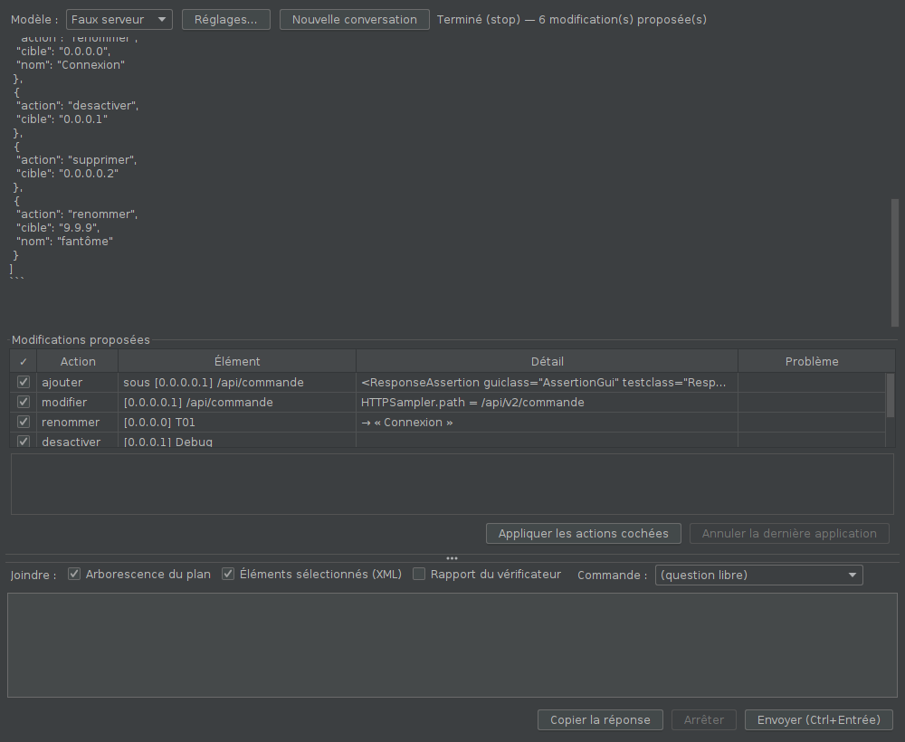
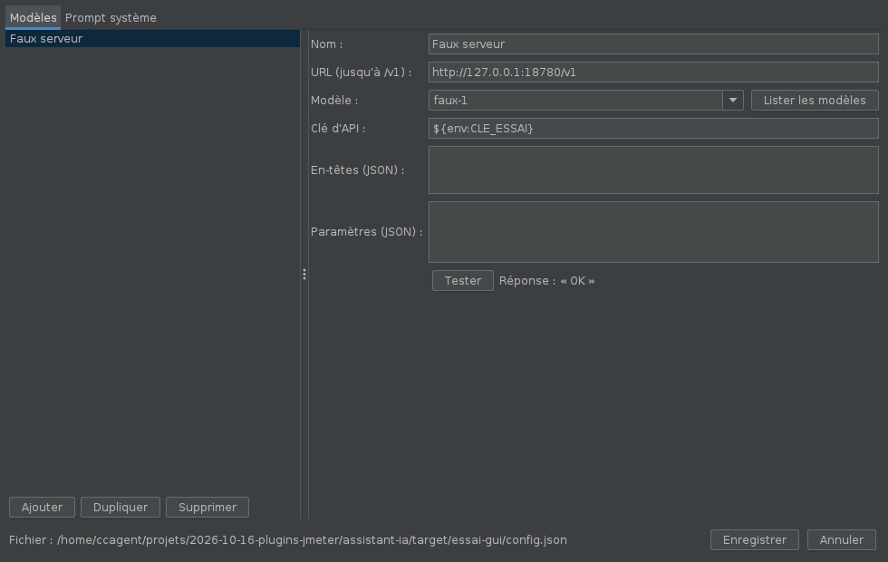

# Assistant IA

Un assistant IA **dans JMeter**, dans l'esprit de Continue pour VS Code :

- **n'importe quel modèle** joignable par l'**API OpenAI** (`/v1/chat/completions`) :
  Ollama, LM Studio, llama.cpp / llama-swap, vLLM, Mistral, OpenRouter, OpenAI,
  Azure OpenAI, ou un service d'entreprise compatible ;
- un **prompt système adapté à JMeter 5.4.3**, modifiable ;
- l'**arborescence du plan**, le **XML des éléments sélectionnés** et le
  **rapport du vérificateur** joints à la question ;
- des **modifications du plan proposées par l'IA**, avec aperçu, application
  et annulation.



## Installation

Compatible JMeter 5.4.3 et plus récent, Java 11 (bytecode Java 8). Aucune
dépendance à ajouter : le JSON passe par la bibliothèque Jackson livrée avec
JMeter.

1. Fermer JMeter et copier `assistant-ia-0.1.0.jar` dans `lib\ext`.
2. Relancer JMeter : **Outils > Assistant IA…**, ou clic droit dans l'arbre
   > **Assistant IA…**.

Le plugin n'ajoute rien au plan : un plan modifié avec lui tourne partout.

## Brancher un modèle

**Réglages…** dans la fenêtre :



| Champ | Exemple |
|---|---|
| URL (jusqu'à `/v1`) | `http://localhost:11434/v1` (Ollama), `http://localhost:1234/v1` (LM Studio), `https://api.openai.com/v1`, `https://api.mistral.ai/v1`, `https://openrouter.ai/api/v1` |
| Modèle | identifiant côté serveur ; **Lister les modèles** interroge `/v1/models` |
| Clé d'API | envoyée en `Authorization: Bearer`. Préférer `${env:NOM_DE_VARIABLE}` : la clé reste dans l'environnement et pas dans le fichier |
| En-têtes (JSON) | en-têtes ajoutés à chaque requête, par exemple `{"api-key": "${env:AZURE_OPENAI_KEY}"}` pour Azure OpenAI |
| Paramètres (JSON) | ajoutés tels quels au corps de la requête : `{"temperature": 0.2}`, `{"chat_template_kwargs": {"enable_thinking": false}}`… |

**Tester** envoie une petite question. Plusieurs profils peuvent coexister ;
on change de modèle dans la liste en haut de la fenêtre.

**Aucune limite de tokens n'est envoyée** par défaut (pas de `max_tokens`) :
seule celle du serveur s'applique. Pour en imposer une, l'ajouter dans les
paramètres du profil.

Les réglages sont dans `~/.jmeter-assistant-ia.json` (autre emplacement :
`-Dassistant.ia.config=…` au lancement de JMeter), lisible par son seul
propriétaire sous Linux et macOS. Le proxy d'entreprise se règle comme pour
JMeter (options `-H` / `-P`, ou `system.properties`).

### Exemple de fichier

```json
{
  "profils": [
    { "nom": "Ollama", "url": "http://localhost:11434/v1", "modele": "qwen2.5-coder:14b", "cle": "" },
    { "nom": "Azure OpenAI", "url": "https://MON-RESSOURCE.openai.azure.com/openai/v1",
      "modele": "MON-DEPLOIEMENT", "cle": "", "entetes": { "api-key": "${env:AZURE_OPENAI_KEY}" } },
    { "nom": "Mistral", "url": "https://api.mistral.ai/v1", "modele": "mistral-large-latest",
      "cle": "${env:MISTRAL_API_KEY}", "parametres": { "temperature": 0.2 } }
  ],
  "profilActif": "Ollama",
  "promptSysteme": "",
  "commandes": {},
  "contexteMax": 60000
}
```

`promptSysteme` vide = prompt par défaut ; `commandes` vide = commandes par
défaut (voir plus bas). Les noms de modèles ci-dessus sont des exemples.

## Utilisation

1. Sélectionner dans l'arbre ce dont on parle (une requête, une transaction,
   un groupe…).
2. Écrire la question, ou choisir une **commande** : *Expliquer la sélection*,
   *Ajouter des assertions*, *Ajouter des temps de réflexion*, *Paramétrer
   avec un CSV*, *Nommer les requêtes*, *Corriger d'après le vérificateur*.
3. **Joindre** : arborescence du plan (cochée), XML des éléments sélectionnés
   (coché), rapport du vérificateur (si le plugin *vérificateur de script* est
   installé).
4. **Envoyer** (Ctrl+Entrée). La réponse s'affiche au fil de l'eau ; pour un
   modèle qui réfléchit, le bandeau indique la longueur de sa réflexion.
   **Arrêter** interrompt.
5. Si l'IA propose des modifications, elles apparaissent sous la conversation :
   une ligne par action, avec l'élément visé et le détail (le XML complet en
   cliquant sur la ligne). Décocher ce qu'on ne veut pas, puis **Appliquer les
   actions cochées**. **Annuler la dernière application** remet tout en place.

La conversation garde l'historique (**Nouvelle conversation** pour
repartir de zéro). Le contexte n'est joint qu'à la dernière question : les
identifiants que l'IA cite désignent toujours l'état présent du plan.

## Comment l'IA modifie le plan

Le prompt système décrit à l'IA un petit langage d'actions, à rendre dans un
bloc de code `jmeter-actions` (un tableau JSON). Ce format fonctionne avec
**n'importe quel modèle**, sans dépendre des « appels d'outils », que tous ne
gèrent pas.

| Action | Effet |
|---|---|
| `modifier` | change des propriétés simples (`HTTPSampler.path`, `ThreadGroup.num_threads`…), en gardant leur type |
| `renommer`, `activer`, `desactiver` | — |
| `supprimer` | l'élément et son contenu |
| `ajouter` | insère un fragment JMX (format de sauvegarde de JMeter) sous un parent, à la fin ou à une position |
| `remplacer` | remplace un élément par un fragment JMX (paramètres, en-têtes…) |
| `deplacer` | change de parent ou de position |

Garde-fous :

- **validation par JMeter avant d'appliquer** : chaque élément proposé est
  chargé, puis comparé à un élément neuf du même type ; une propriété que
  JMeter ne connaît pas est signalée (« ⚠ propriété inconnue ») — c'est le
  cas typique d'un modèle qui invente un nom (`ConstantTimer.value` au lieu de
  `ConstantTimer.delay`) : sans ce contrôle, l'élément serait créé avec la
  vraie propriété à sa valeur par défaut, sans erreur visible. Un XML que
  JMeter ne sait pas lire est refusé ;
- le prompt contient un **catalogue** du XML exact des éléments les plus
  demandés (minuteries, en-têtes, CSV, extracteurs JSON et regex), vérifié
  par l'essai automatique ;
- les éléments sont désignés par les identifiants de l'arborescence jointe
  (`[0.1.3]`) ; une action sur un identifiant inconnu est signalée et
  décochée ;
- la lecture du JSON est tolérante (virgule finale, retour à la ligne dans le
  XML) ; un `<hashTree/>` oublié après un élément est ajouté ;
- **rien n'est modifié sans « Appliquer »**, et tout s'annule ;
- une action qui échoue (XML invalide, élément inconnu de JMeter…) est
  signalée sans empêcher les autres.

## Confidentialité

La question et le contexte joint (arborescence, XML de la sélection, rapport)
partent vers le serveur du profil choisi : URL, noms de requêtes, valeurs
saisies dans le plan. Avec un service en ligne, ne pas joindre de plan
contenant des secrets, ou utiliser un modèle local. Décocher **Joindre**
pour ne rien envoyer d'autre que la question.

## Limites

- Les réponses dépendent du modèle : un petit modèle local peut produire un XML
  JMX inexact ; l'aperçu et l'annulation sont là pour ça.
- Le contexte est plafonné (`contexteMax`, 60 000 caractères par défaut) :
  sur un très grand plan, l'arborescence est tronquée ; sélectionner la
  partie utile.
- Pas d'appels d'outils ni de lecture de résultats de tir dans cette version.

## Fonctionnement

- `ClientOpenAI` : client HTTP sans dépendance (flux SSE, `reasoning_content`,
  réponses non diffusées, erreurs lisibles, arrêt), qui respecte le proxy de
  la JVM.
- `ConfigAssistant` / `Profil` : réglages JSON, `${env:…}`.
- `PromptSysteme` : prompt par défaut et commandes rapides.
- `Contexte` : arborescence numérotée et XML de la sélection.
- `ActionIA` : lecture et validation du bloc d'actions ;
  `ApplicationActions` : application réversible dans l'arbre.
- `FenetreAssistant`, `FenetreReglages`, `MenuAssistant` (menu Outils et clic
  droit).

## Essais

- `mvn test` : 14 tests (flux SSE, erreurs, corps de requête sans
  `max_tokens`, configuration, lecture des actions, XML).
- `essai-gui/lancer.sh` : vraie interface de JMeter contre un faux serveur
  OpenAI (`faux_openai.py`) — menu, réglages, contexte envoyé, aperçu,
  application, annulation, historique, clé en variable d'environnement,
  enregistrement du plan.
- `essai-gui/EssaiModeleReel.java` : même parcours avec un vrai modèle (profil
  actif du fichier de configuration).

### Essais avec un vrai modèle (2026-10-17)

Bonsai 27B en local (llama-swap, format OpenAI, réflexion active, aucune
limite de tokens), JMeter 5.4.3 / Java 11 :

| Demande | Durée | Résultat |
|---|---|---|
| Ajouter une assertion 200 sur la requête sélectionnée | 45 s | correct (cible juste, XML valide, appliqué) — proche de l'exemple du prompt |
| Ajouter une minuterie de 2 s dans T01 et renommer une requête, **avant** le catalogue | 90 s | renommage juste ; minuterie **fausse** (propriétés inventées), d'où la validation |
| Même demande **avec** le catalogue | 45 s | correct (`ConstantTimer.delay` = 2000) |
