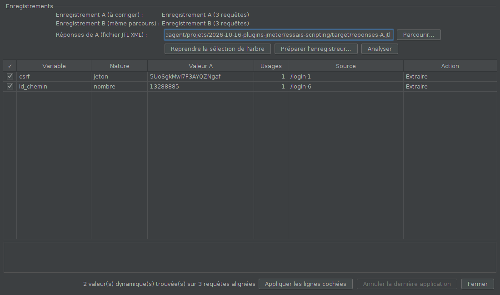

# Corrélation assistée

Repère les **valeurs dynamiques** d'un script enregistré (jeton CSRF,
identifiant de session, numéro de commande, ViewState…) en **comparant deux
enregistrements du même parcours**, puis, pour chacune :

- crée un **Boundary Extractor** sur la requête dont la réponse fournit la
  valeur, avec des bornes calculées automatiquement ;
- remplace la valeur par `${variable}` dans toutes les requêtes suivantes.

Les horodatages sont remplacés par `${__time()}`. Tout fonctionne hors
ligne, sans règles à écrire à l'avance.

## Installation

Compatible JMeter 5.4.3 et plus récent, Java 11 (bytecode Java 8).

1. Fermer JMeter et copier `correlation-assistee-0.1.1.jar` dans `lib\ext`.
2. Relancer JMeter.

Les extracteurs créés sont des Boundary Extractor standards : le plan tourne
partout sans le plugin.

## Utilisation

1. **Préparer** : un plan avec un enregistreur HTTP(S) (de préférence
   l'*enregistreur sans variables*) et deux Recording Controller, A et B.
   Ouvrir **Outils > Corrélation assistée…** puis **Préparer
   l'enregistreur…** : un récepteur « Réponses pour la corrélation » est
   ajouté sous l'enregistreur, réglé pour sauver les réponses au bon format
   (XML, corps et en-têtes des réponses).
2. **Enregistrer le parcours A** dans le contrôleur A.
3. **Désactiver** le récepteur « Réponses pour la corrélation », puis
   **enregistrer le même parcours B** dans le contrôleur B (nouvelle session :
   se déconnecter, ou fermer le navigateur).
4. (Facultatif) **Nettoyer** A et B (plugin *Nettoyage d'enregistrement*).
5. Sélectionner **A puis B** dans l'arbre (Ctrl+clic ; A est celui qui vient
   en premier dans l'arbre), **Reprendre la sélection de l'arbre**, vérifier le
   fichier des réponses, **Analyser**.
6. Relire le tableau : variable (modifiable), nature, valeur, nombre
   d'usages, requête source, action (*Extraire*, *Remplacer par
   ${__time()}*, *Ignorer*). Cliquer une ligne pour le détail : où la valeur
   est utilisée, d'où elle est extraite, bornes.
7. **Appliquer les lignes cochées**. **Annuler la dernière application**
   rétablit tout tant que la fenêtre est ouverte.
8. Supprimer ou désactiver B, l'enregistreur et le récepteur, rejouer A.

## Ce qui est détecté

- Les requêtes de A et B sont **alignées** (méthode + chemin, les segments
  numériques ou identifiants étant neutralisés), ce qui tolère une requête de
  plus ou de moins d'un côté.
- Une valeur est dynamique si elle diffère entre A et B dans un paramètre, un
  en-tête, un segment de chemin ou le corps (comparé jeton par jeton). Sont
  ignorés : valeurs de moins de 4 caractères (sauf nombres), en-têtes
  `Cookie` (gérés par le Cookie Manager), `Host`, `Referer`, `User-Agent`,
  `Content-Length`, `Accept-Language`, `If-Modified-Since`, `If-None-Match`.
- Chaque valeur est rattachée à **tous** les endroits de A où elle est
  envoyée.
- Nature : jeton, UUID, nombre, horodatage (10 ou 13 chiffres), texte.

## Source et bornes

La source est la **première réponse**, parmi les requêtes qui précèdent la
première utilisation, qui contient la valeur (corps d'abord, puis
en-têtes). Les réponses du fichier sont associées aux requêtes de A par
méthode et chemin, dans l'ordre.

Bornes : à droite, les caractères de fin qui suivent la valeur (`"`, `'`,
`<`, `&`, `;`…) ; à gauche, le contexte le plus court (3 à 40 caractères) qui
désigne sans ambiguïté la bonne occurrence. Valeur par défaut de l'extracteur
: `NON_TROUVE_<variable>`, pour repérer un échec au rejeu.

Sans fichier de réponses, l'analyse liste les valeurs dynamiques mais ne
peut proposer aucun extracteur (action *Ignorer* par défaut).

## Limites

- Valeurs encodées différemment dans la réponse et dans la requête (URL
  encodée, échappement JSON ou HTML) : la source n'est pas trouvée.
- Une valeur calculée par JavaScript côté navigateur n'apparaît dans aucune
  réponse : à traiter à la main.
- Un seul extracteur par valeur, sur la première occurrence (`match_number`
  = 1).

## Fonctionnement

- `Requete`, `Correlation`, `Bornes` : alignement, détection, bornes, sans
  JMeter, testés seuls.
- `LectureJtl` : lecture des réponses du fichier XML.
- `LiaisonArbre`, `Application`, `PreparationEnregistreur` : lecture de
  l'arbre, création des extracteurs, remplacements (réversibles).

## Essais

- `mvn test` : alignement, détection, bornes.
- `../essais-scripting/lancer.sh` : deux enregistrements réels d'une
  application qui exige un vrai jeton CSRF et un vrai numéro de commande,
  nettoyage, corrélation, puis **rejeu du plan corrigé, qui doit passer**.
