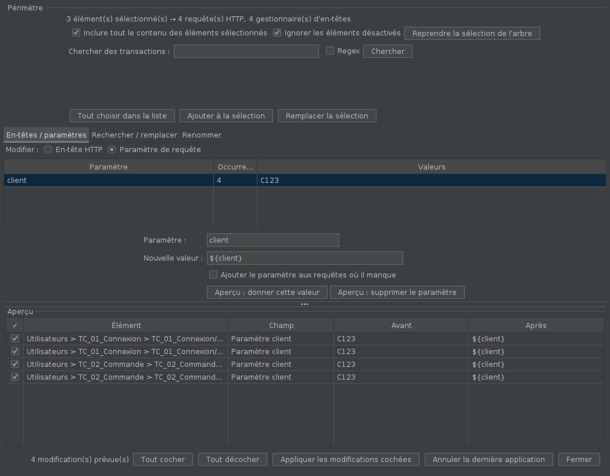
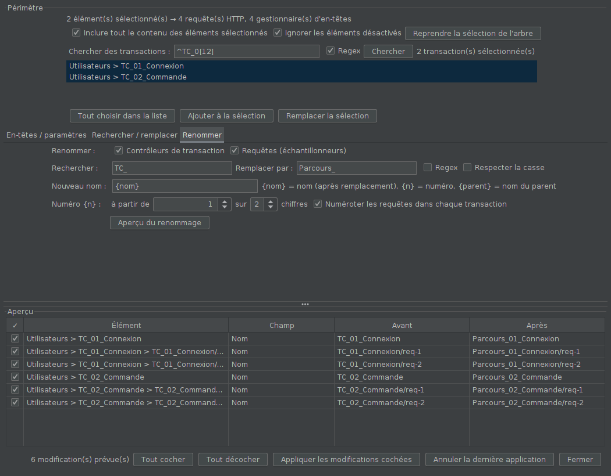

# Modification en masse

Modifier d'un coup les requêtes et les en-têtes de plusieurs éléments
sélectionnés dans l'arbre JMeter, au lieu de cliquer sur chacun. Par
exemple, donner `Bearer ${token}` à l'en-tête `Authorization`, ou `${client}`
au paramètre `client`, dans toutes les requêtes de plusieurs transactions.

**Version 0.3.0** : **chercher des transactions** par leur nom et les ajouter
à la sélection, et onglet **Renommer** (contrôleurs de transaction et
requêtes : rechercher / remplacer, modèle de nom, numérotation).
Depuis la 0.2.0, le premier onglet choisit sa cible, **en-tête HTTP** ou
**paramètre de requête**.

## Installation

Compatible JMeter 5.4.3 et plus récent, Java 11 (bytecode Java 8).

1. Fermer JMeter, **retirer l'ancienne version** (`modification-en-masse-0.x.x.jar`)
   de `lib\ext` si elle y est, et copier `modification-en-masse-0.3.1.jar`
   à la place (par exemple `C:\apache-jmeter-5.4.3\lib\ext\`).
2. Relancer JMeter.

Le plugin n'ajoute **aucun élément au plan de test** : un plan modifié avec
lui s'ouvre et tourne partout, injecteurs compris, sans le plugin.

## Utilisation

1. Dans l'arbre, sélectionner les éléments à modifier : **Ctrl+clic** pour
   en ajouter un, **Maj+clic** pour une plage. Des transactions, des
   requêtes, un groupe d'unités entier… (On peut aussi les trouver par
   leur nom depuis la fenêtre : voir « Chercher des transactions ».)
2. **Clic droit > Modification en masse…** (la sélection multiple est
   conservée), ou menu **Outils > Modification en masse…**.
3. Préparer la modification dans l'un des deux onglets, puis cliquer sur
   **Aperçu**.
4. Relire l'aperçu, décocher les lignes à épargner, puis cliquer sur
   **Appliquer les modifications cochées**.
5. Enregistrer le plan (Ctrl+S).

La fenêtre reste ouverte pendant qu'on travaille dans l'arbre : changer la
sélection, puis cliquer sur **Reprendre la sélection de l'arbre**.

### Périmètre

Par défaut, la modification porte sur les éléments sélectionnés **et tout
leur contenu** : sélectionner une transaction touche ses requêtes et les
gestionnaires d'en-têtes placés sous elles. Le bandeau indique combien de
requêtes et de gestionnaires d'en-têtes sont concernés. Options : ne prendre
que les éléments sélectionnés eux-mêmes, ignorer ou non les éléments
désactivés (ignorés par défaut).

### Chercher des transactions

Dans le cadre **Périmètre**, le champ **Chercher des transactions** liste les
contrôleurs de transaction de **tout le plan** dont le nom contient le texte
saisi (sans tenir compte des majuscules ; option *Regex* ; champ vide = toutes).
Choisir dans la liste (Ctrl+clic, Maj+clic, ou **Tout choisir dans la
liste**), puis :

- **Ajouter à la sélection** : les transactions s'ajoutent à ce qui est déjà
  sélectionné dans l'arbre ;
- **Remplacer la sélection** : elles deviennent la sélection.

La sélection de l'arbre de JMeter suit, et le périmètre est recalculé.

### Onglet « En-têtes / paramètres »

En haut, **Modifier :** choisit la cible :

- **En-tête HTTP** : les en-têtes des gestionnaires d'en-têtes (*HTTP Header
  Manager*). Nom comparé sans tenir compte des majuscules, comme le fait HTTP.
- **Paramètre de requête** : les paramètres des requêtes HTTP, d'URL ou de
  formulaire. Nom comparé **en respectant la casse** (`client` et `Client`
  sont deux paramètres). Les requêtes dont le corps est brut (*Body Data*,
  JSON par exemple) n'ont pas de paramètres : elles sont ignorées ; pour
  elles, utiliser l'onglet *Rechercher / remplacer*, champ « Paramètres et
  corps ».

La liste montre les noms trouvés dans le périmètre, avec leur nombre et
leurs valeurs. Choisir un nom (ou en saisir un nouveau), puis :

- **donner cette valeur** à toutes ses occurrences, par exemple
  `Bearer ${token}` ou `${client}`. La case « Ajouter … où il manque »
  l'ajoute aussi là où il n'est pas : dans chaque gestionnaire d'en-têtes,
  ou dans chaque requête (un paramètre ajouté est encodé dans l'URL à
  l'envoi, comme un paramètre ajouté à la main) ;
- **supprimer** l'en-tête ou le paramètre partout.

### Onglet « Rechercher / remplacer »

Remplace un texte, ou une expression régulière avec l'option *Regex*, dans
les champs cochés :

| Champ | Ce qui est touché |
|---|---|
| Valeurs des en-têtes | la valeur de chaque en-tête |
| Paramètres et corps | noms et valeurs des paramètres, corps brut (*Body Data*) |
| Chemin | le chemin de la requête |
| Serveur, port, protocole | les champs du même nom |
| Noms des éléments | le nom des transactions, requêtes, etc. (décoché par défaut) |

Dans le texte de remplacement, `${...}` est toujours pris à la lettre : c'est
une variable JMeter, même en mode regex. En mode regex, `$1`, `$2`…
reprennent les groupes capturés. Par exemple
`/api/v(\d+)/commande/(\d+)` → `/api/v$1/commande/${id_$2}`.

### Onglet « Renommer »

Renomme, dans le périmètre, les **contrôleurs de transaction** (le nom de la
transaction dans les résultats), les **requêtes** (tous les échantillonneurs),
ou les deux :

1. **Rechercher / Remplacer par** (facultatif) s'applique d'abord au nom, en
   texte ou en regex (`$1`, `$2`… pour les groupes).
2. **Nouveau nom** est un modèle :
   - `{nom}` : le nom après remplacement ;
   - `{n}` : un numéro, **à partir de** N, **sur** N chiffres (`01`, `02`…) ;
   - `{parent}` : le nom de l'élément parent (son nouveau nom s'il est
     renommé dans le même lot).
3. La numérotation est propre à chaque type. Avec **Numéroter les requêtes
   dans chaque transaction**, celle des requêtes repart du début dans chaque
   contrôleur de transaction.

Exemples :

| Objectif | Renommer | Rechercher → Remplacer | Nouveau nom | Résultat |
|---|---|---|---|---|
| Préfixer les transactions | transactions | — | `Achat_{nom}` | `TC_01` → `Achat_TC_01` |
| Renuméroter les transactions | transactions | `^TC_\d+_` → *(vide)*, regex | `T{n}_{nom}` | `TC_07_Login` → `T01_Login` |
| Nommer les requêtes d'après leur transaction | requêtes | — | `{parent}_R{n}` | `/api/login-12` → `T01_Login_R01` |
| Changer un mot partout | les deux | `TC_` → `Parcours_` | `{nom}` | `TC_01` → `Parcours_01` |

Si le plan contient des **Module Controller**, l'aperçu le signale : ils
désignent leur cible par son nom, à vérifier après un renommage de
transaction.

### Sécurité

- **Rien n'est modifié sans passer par l'aperçu.**
- Si un élément a changé entre l'aperçu et l'application, sa ligne est
  écartée, pas forcée. Le bilan l'indique.
- **Annuler la dernière application** rétablit les valeurs d'avant, tant que
  la fenêtre n'a pas été fermée. (L'annulation native de JMeter, Ctrl+Z, est
  désactivée par défaut et ne couvre pas ces modifications.)
- Le plan est marqué comme modifié : JMeter proposera de l'enregistrer.

## Limites

- Ne connaît que les requêtes HTTP et les gestionnaires d'en-têtes (plus les
  noms de tous les éléments). Les autres éléments (JDBC, extracteurs,
  assertions…) ne sont pas modifiés.
- Le menu **Édition** de JMeter n'accueille pas l'entrée : JMeter le
  reconstruit à chaque clic dans l'arbre et efface les entrées des plugins.
  D'où le menu **Outils** et le clic droit.

## Fonctionnement

- `MenuModificationMasse` implémente l'interface `MenuCreator` de JMeter,
  qui la trouve seule dans `lib/ext` (menu Outils). Le menu clic droit de
  l'arbre n'a pas de point d'extension : l'entrée y est ajoutée juste après
  que JMeter l'a affiché.
- `MoteurModification` calcule les modifications sans interface (testé
  seul) ; chaque `Modification` sait relire, écrire et défaire sa valeur.
- Avant de lire et avant d'écrire, la fenêtre fait enregistrer par JMeter
  ce qui est en cours de saisie dans l'écran ouvert, et elle rafraîchit cet
  écran ensuite. Sans cela, JMeter réécrirait l'ancienne valeur depuis
  l'écran en changeant de sélection.

## Essais

- `mvn test` : 27 tests du moteur (périmètre, en-têtes, paramètres de
  requête — casse, corps brut ignoré, ajout et annulation —, remplacement
  texte et regex, noms, recherche de transactions, renommage — modèle,
  numérotation globale ou par transaction, `{parent}` —, lignes décochées,
  modification périmée, annulation).
- `essai-gui/lancer.sh` : essai dans la vraie interface de JMeter (5.4.3 par
  défaut) sous écran virtuel. Il sélectionne 2 transactions sur 3, passe par
  le menu clic droit et la fenêtre (en-tête, paramètre, remplacement du
  serveur, recherche et ajout de transactions, renommage des transactions
  puis des requêtes),
  vérifie qu'un écran resté ouvert n'écrase pas la modification, enregistre
  par la commande *Enregistrer* puis relit le fichier.
