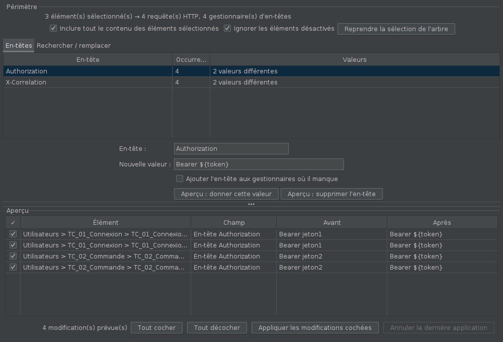
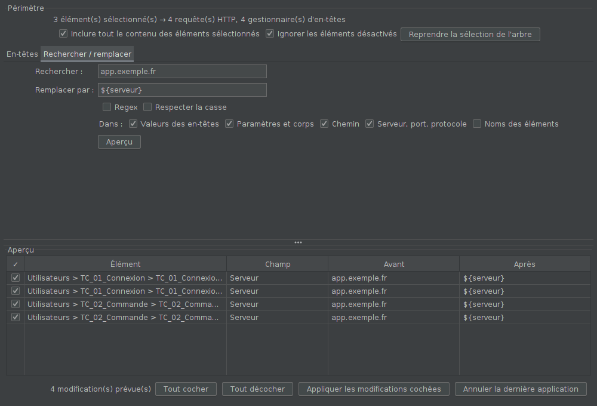

# Modification en masse

Modifier d'un coup les requêtes et les en-têtes de plusieurs éléments
sélectionnés dans l'arbre JMeter, au lieu de cliquer sur chacun. Par
exemple, donner `Bearer ${token}` à l'en-tête `Authorization` de toutes les
requêtes de plusieurs transactions.

## Installation

Compatible JMeter 5.4.3 et plus récent, Java 11 (bytecode Java 8).

1. Fermer JMeter et copier `modification-en-masse-0.1.0.jar` dans `lib\ext`
   (par exemple `C:\apache-jmeter-5.4.3\lib\ext\`).
2. Relancer JMeter.

Le plugin n'ajoute **aucun élément au plan de test** : un plan modifié avec
lui s'ouvre et tourne partout, injecteurs compris, sans le plugin.

## Utilisation

1. Dans l'arbre, sélectionner les éléments à modifier : **Ctrl+clic** pour
   en ajouter un, **Maj+clic** pour une plage. Des transactions, des
   requêtes, un groupe d'unités entier…
2. **Clic droit > Modification en masse…** (la sélection multiple est
   conservée), ou menu **Outils > Modification en masse…**.
3. Préparer la modification dans l'un des deux onglets, puis cliquer sur
   **Aperçu**.
4. Relire l'aperçu, décocher les lignes à épargner, puis cliquer sur
   **Appliquer les modifications cochées**.
5. Enregistrer le plan (Ctrl+S).

La fenêtre reste ouverte pendant qu'on travaille dans l'arbre : changer la
sélection, puis cliquer sur **Reprendre la sélection de l'arbre**.

### Périmètre

Par défaut, la modification porte sur les éléments sélectionnés **et tout
leur contenu** : sélectionner une transaction touche ses requêtes et les
gestionnaires d'en-têtes placés sous elles. Le bandeau indique combien de
requêtes et de gestionnaires d'en-têtes sont concernés. Options : ne prendre
que les éléments sélectionnés eux-mêmes, ignorer ou non les éléments
désactivés (ignorés par défaut).

### Onglet « En-têtes »

Liste les en-têtes présents dans le périmètre, avec leur nombre et leurs
valeurs. Choisir un en-tête (ou en saisir un nouveau), puis :

- **donner cette valeur** à toutes ses occurrences, par exemple
  `Bearer ${token}`. La case « Ajouter l'en-tête aux gestionnaires où il
  manque » l'ajoute aussi là où il n'est pas ;
- **supprimer l'en-tête** partout.

Le nom de l'en-tête est comparé sans tenir compte des majuscules.

### Onglet « Rechercher / remplacer »

Remplace un texte, ou une expression régulière avec l'option *Regex*, dans
les champs cochés :

| Champ | Ce qui est touché |
|---|---|
| Valeurs des en-têtes | la valeur de chaque en-tête |
| Paramètres et corps | noms et valeurs des paramètres, corps brut (*Body Data*) |
| Chemin | le chemin de la requête |
| Serveur, port, protocole | les champs du même nom |
| Noms des éléments | le nom des transactions, requêtes, etc. (décoché par défaut) |

Dans le texte de remplacement, `${...}` est toujours pris à la lettre : c'est
une variable JMeter, même en mode regex. En mode regex, `$1`, `$2`…
reprennent les groupes capturés. Par exemple
`/api/v(\d+)/commande/(\d+)` → `/api/v$1/commande/${id_$2}`.

### Sécurité

- **Rien n'est modifié sans passer par l'aperçu.**
- Si un élément a changé entre l'aperçu et l'application, sa ligne est
  écartée, pas forcée. Le bilan l'indique.
- **Annuler la dernière application** rétablit les valeurs d'avant, tant que
  la fenêtre n'a pas été fermée. (L'annulation native de JMeter, Ctrl+Z, est
  désactivée par défaut et ne couvre pas ces modifications.)
- Le plan est marqué comme modifié : JMeter proposera de l'enregistrer.

## Limites

- Ne connaît que les requêtes HTTP et les gestionnaires d'en-têtes (plus les
  noms de tous les éléments). Les autres éléments (JDBC, extracteurs,
  assertions…) ne sont pas modifiés.
- Le menu **Édition** de JMeter n'accueille pas l'entrée : JMeter le
  reconstruit à chaque clic dans l'arbre et efface les entrées des plugins.
  D'où le menu **Outils** et le clic droit.

## Fonctionnement

- `MenuModificationMasse` implémente l'interface `MenuCreator` de JMeter,
  qui la trouve seule dans `lib/ext` (menu Outils). Le menu clic droit de
  l'arbre n'a pas de point d'extension : l'entrée y est ajoutée juste après
  que JMeter l'a affiché.
- `MoteurModification` calcule les modifications sans interface (testé
  seul) ; chaque `Modification` sait relire, écrire et défaire sa valeur.
- Avant de lire et avant d'écrire, la fenêtre fait enregistrer par JMeter
  ce qui est en cours de saisie dans l'écran ouvert, et elle rafraîchit cet
  écran ensuite. Sans cela, JMeter réécrirait l'ancienne valeur depuis
  l'écran en changeant de sélection.

## Essais

- `mvn test` : 13 tests du moteur (périmètre, en-têtes, remplacement texte
  et regex, paramètres, noms, lignes décochées, modification périmée,
  annulation).
- `essai-gui/lancer.sh` : essai dans la vraie interface de JMeter (5.4.3 par
  défaut) sous écran virtuel. Il sélectionne 2 transactions sur 3, passe par
  le menu clic droit et la fenêtre (en-tête puis remplacement du serveur),
  vérifie qu'un écran resté ouvert n'écrase pas la modification, enregistre
  par la commande *Enregistrer* puis relit le fichier.
