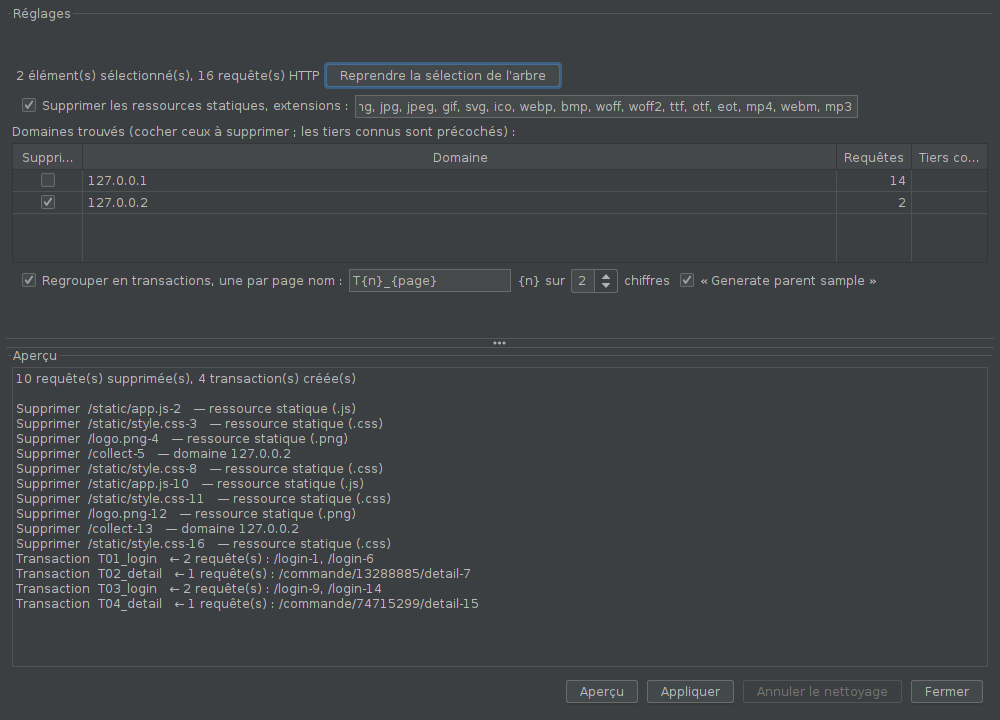

# Nettoyage d'enregistrement

Après un enregistrement HTTP(S), en une passe :

- **supprimer les ressources statiques** (`.js`, `.css`, images, polices…) ;
- **supprimer les domaines tiers** (mesure d'audience, publicité, supervision),
  les plus courants étant précochés ;
- **regrouper les requêtes en transactions, une par page**.

## Installation

Compatible JMeter 5.4.3 et plus récent, Java 11 (bytecode Java 8).

1. Fermer JMeter et copier `nettoyage-enregistrement-0.1.1.jar` dans `lib\ext`.
2. Relancer JMeter.

Le plugin n'ajoute aucun élément propre au plan (les transactions créées sont
des Transaction Controller standards) : le plan tourne partout sans lui.

## Utilisation

1. Sélectionner dans l'arbre l'enregistrement à nettoyer : le Recording
   Controller, un groupe d'unités… (plusieurs avec Ctrl+clic).
2. Menu **Outils > Nettoyer un enregistrement…**
3. Régler, **Aperçu**, relire, **Appliquer**.
4. **Annuler le nettoyage** remet tout en place tant que la fenêtre est
   ouverte.

### Ressources statiques

Une requête est statique si l'extension de son chemin (query string retirée)
est dans la liste, modifiable. Par défaut : css, js, mjs, map, png, jpg, jpeg,
gif, svg, ico, webp, bmp, woff, woff2, ttf, otf, eot, mp4, webm, mp3.

### Domaines

La liste montre chaque domaine trouvé et son nombre de requêtes. Les domaines
tiers connus sont précochés (Google Analytics et Tag Manager, DoubleClick,
Facebook, Hotjar, Clarity, LinkedIn, New Relic, Dynatrace, Segment,
Mixpanel, OneTrust, Sentry…). Cocher ou décocher librement.

### Regroupement en transactions

Une nouvelle transaction commence à chaque **page principale** : requête dont
l'en-tête `Accept` enregistré contient `text/html`, ou GET sans en-tête
`Accept`, et qui n'est pas une ressource statique. Les appels qui suivent (XHR,
JSON, POST de formulaire…) rejoignent la page en cours.

Le nom suit le modèle `T{n}_{page}` (modifiable) : `{n}` est le numéro, sur
N chiffres ; `{page}` est tiré de l'URL de la page (`/fr/compte/commandes.aspx`
→ `commandes`, `/` → `accueil`). « Generate parent sample » est coché par
défaut. Pour renommer ensuite : onglet *Renommer* de la modification en masse.

Seules les requêtes placées **directement** sous l'élément sélectionné sont
regroupées ; celles déjà dans une transaction sont laissées telles quelles
(l'aperçu les compte).

## Fonctionnement

- `AnalyseEnregistrement` : décisions (statique, tiers, page, nom), sans
  JMeter, testées seules.
- `Nettoyage` : lecture des requêtes de l'arbre et plan d'action ;
  `OperationsArbre` : suppressions, insertions et déplacements de nœuds,
  enregistrés pour l'annulation.

## Essais

- `mvn test` : logique de décision.
- `../essais-scripting/lancer.sh` : enregistrement réel puis nettoyage dans la
  vraie interface de JMeter (voir son en-tête).
