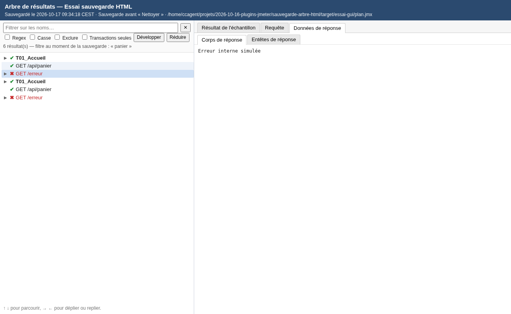

# Sauvegarde HTML de l'arbre de résultats

Un bouton de plus dans la barre d'outils de JMeter, juste après **Nettoyer** et
**Nettoyer tout** : **Sauvegarder en HTML puis nettoyer**. Avant de vider
l'arbre de résultats, il en écrit une copie dans une **page HTML autonome**.
La page ne contient que les résultats des arbres et reproduit la page de
l'arbre de résultats : l'arbre à gauche, les onglets à droite.

Compatible avec l'**arbre de résultats filtrable** (plugin du même dépôt). La
page contient **tous** ses résultats, y compris ceux que son filtre masquait,
et elle s'ouvre avec ce même filtre.

## Installation

Compatible JMeter 5.4.3 et plus récent, Java 11 (bytecode Java 8). Aucune
dépendance à ajouter.

1. Fermer JMeter et copier `sauvegarde-arbre-html-0.1.1.jar` dans `lib\ext`.
2. Relancer JMeter.

Le plugin n'ajoute rien au plan de test : les plans tournent partout sans lui.
L'arbre de résultats filtrable n'est pas nécessaire. S'il est installé, il est
pris en charge des versions 0.1.1 à 0.2.1.

## Utilisation

Le bouton (le balai de « Nettoyer tout », avec une disquette bleue) agit
selon l'élément affiché :

| Élément affiché | Sauvegardé | Puis |
|---|---|---|
| un arbre de résultats (standard ou filtrable) | cet arbre | **Nettoyer** : cet arbre seul est vidé |
| autre chose (plan, groupe, requête…) | tous les arbres de résultats du plan, dans une seule page | **Nettoyer tout** : tous les récepteurs sont vidés |

- **Si l'écriture échoue** (dossier interdit, disque plein), un message
  l'indique et **rien n'est nettoyé**. La page est d'abord écrite dans un
  fichier temporaire puis renommée : il n'existe jamais de page à moitié
  écrite.
- Si les arbres sont vides, le bouton nettoie sans créer de fichier.
- Un message donne le chemin de la page, avec deux boutons : **Ouvrir**
  (navigateur) et **Copier le chemin**.

Les mêmes commandes se trouvent dans le menu **Lancer**, à côté de
« Nettoyer » et « Nettoyer tout » :

- **Sauvegarder en HTML puis nettoyer** : comme le bouton ;
- **Sauvegarder tous les arbres en HTML puis nettoyer tout** ;
- **Sauvegarder les arbres de résultats en HTML…** : choisir le fichier, **sans
  rien nettoyer**.

### Où va la page

Le fichier est placé à côté du `.jmx` et nommé
`<plan>_arbre-resultats_AAAAMMJJ-HHMMSS.html`. Si le plan n'a pas encore été
enregistré, il va dans le dossier personnel. Un suffixe `-2`, `-3`… est ajouté
si le nom existe déjà.

Réglages facultatifs, dans `user.properties` :

| Propriété | Défaut | Effet |
|---|---|---|
| `sauvegarde.arbre.html.dossier` | dossier du `.jmx` | dossier de destination des pages |
| `sauvegarde.arbre.html.max_caracteres` | `1000000` | taille maximale gardée par réponse ; `0` : sans limite |
| `sauvegarde.arbre.html.message` | `true` | `false` : pas de message après la sauvegarde |

## La page HTML

- **Un seul fichier**, sans aucune ressource externe : elle s'ouvre hors ligne
  et peut être envoyée telle quelle.
- **À gauche, l'arbre** :
  - transactions et requêtes, avec ✔ vert ou ✖ rouge ;
  - les assertions en échec apparaissent en nœuds enfants, comme dans JMeter ;
  - déplier ou replier au clic, ou avec *Développer* / *Réduire* ;
  - parcours au clavier avec les flèches ↑ ↓ → ←.
- **Le filtre de l'arbre filtrable** : sur les noms, à la frappe, avec les
  options *Regex*, *Casse*, *Exclure* et *Transactions seules*. Il suit les
  mêmes règles que le plugin : une transaction reste affichée si l'une de ses
  requêtes correspond.
- **À droite, les onglets de JMeter** :
  - **Résultat de l'échantillon** : le même texte que dans JMeter, avec le
    code de réponse en couleur ;
  - **Requête** : corps et en-têtes ;
  - **Données de réponse** : corps et en-têtes. Les images sont affichées, les
    autres contenus binaires sont signalés avec leur taille.
- **Plusieurs arbres** : une liste en haut de page permet de passer de l'un à
  l'autre.
- **Langue** : les libellés des onglets sont ceux de JMeter, dans sa langue.
- **Sécurité** : les réponses sont affichées comme du texte, jamais
  interprétées. Un script contenu dans une page enregistrée ne s'exécute pas.

## Limites

- **Taille** : la page contient les corps de réponse. Avec beaucoup de grosses
  réponses, elle peut peser lourd. JMeter ne garde de toute façon que les
  500 derniers résultats par arbre (`view.results.tree.max_results`).
- **Tir en cours** : un résultat qui arrive pendant la sauvegarde peut être
  nettoyé sans avoir été sauvegardé.
- **Rendus** : seul l'affichage en texte est repris. Les rendus *HTML*,
  *JSON*, *XPath* ou *Regexp Tester* de l'arbre ne le sont pas.
- **Barre d'outils personnalisée** : si `jmeter.toolbar` ne contient pas
  « Nettoyer tout », le bouton se place après « Nettoyer », ou à défaut en fin
  de barre.

## Fonctionnement

- `MenuSauvegarde` (interface `MenuCreator`) : JMeter le trouve seul dans
  `lib/ext`. Il ajoute les entrées du menu Lancer et démarre
  `BoutonSauvegarde`.
- `BoutonSauvegarde` : la barre d'outils de JMeter n'a pas de point
  d'extension. Le bouton y est donc inséré une fois la fenêtre créée, et
  réinséré quand JMeter la reconstruit (changement de langue).
- `CollecteArbres` : lecture des résultats.
  - Le View Results Tree les garde dans un champ privé, `buffer`.
  - L'arbre filtrable garde **tous** les résultats reçus dans `tous`, et
    son filtre dans `filtre`. Ils sont lus par réflexion, sans dépendance de
    compilation entre les deux plugins.
- `ExportHtml` : écriture de la page. Le modèle `modele.html` est complété par
  les données en JSON, écrites au fil de l'eau. Les caractères `<`, `>` et `&`
  sont échappés, pour que `</script>` dans une réponse ne puisse pas fermer le
  bloc.
- `SauvegardeArbres` : écriture, puis action **Nettoyer** ou **Nettoyer tout**
  de JMeter, seulement si l'écriture a réussi.

## Essais

- `mvn test` : 7 tests. Ils portent sur la structure de la page, le texte de
  l'onglet résultat, une réponse piège qui contient `</script>`, la
  troncature, les images et contenus binaires, le filtre transmis, les noms de
  fichiers et l'écriture atomique.
- `essai-gui/lancer.sh` : essai dans la vraie interface de JMeter 5.4.3, avec
  l'arbre filtrable installé à côté et un tir réel contre une petite
  application locale. Il vérifie :
  - la place du bouton et le menu ;
  - la sauvegarde de l'arbre affiché, puis de tous les arbres ;
  - l'échec d'écriture, qui ne nettoie rien ;
  - les arbres vides ;
  - le changement de langue.

  La page produite est ensuite vérifiée dans Chromium : filtre, onglets,
  image, script non exécuté, clavier.
