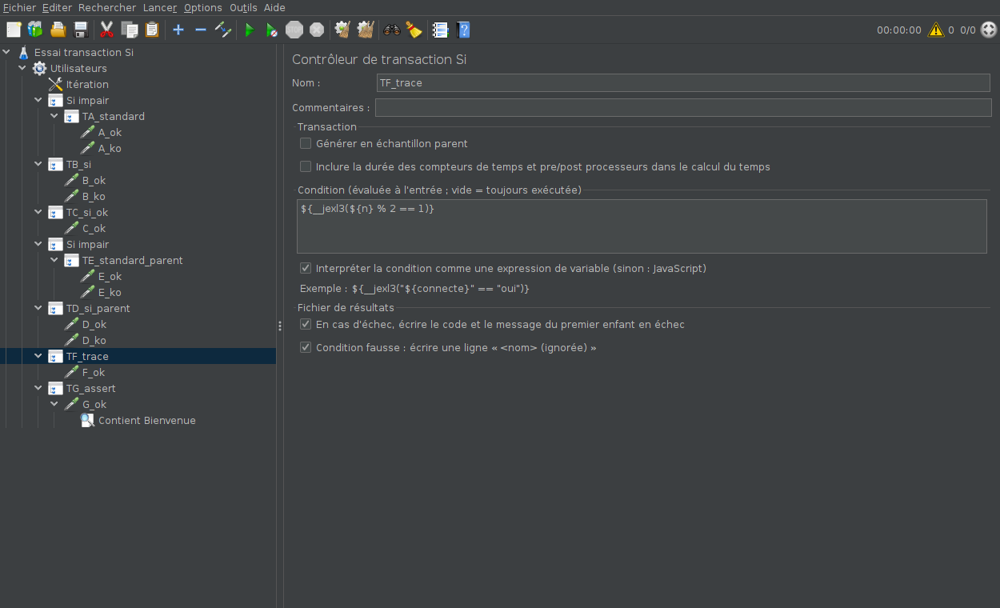

# Contrôleur de transaction Si

Un contrôleur de transaction qui ne s'exécute que si sa condition est vraie :
**un seul élément au lieu d'un Contrôleur Si contenant un contrôleur de
transaction**. Quand la transaction échoue, sa ligne dans le fichier de
résultats dit en plus **quelle requête a échoué et pourquoi**.



## Le problème qu'il règle

Une transaction conditionnelle demande aujourd'hui deux éléments imbriqués :

```
Contrôleur Si             ${__jexl3("${connecte}" == "oui")}
└── Contrôleur de transaction   T03_Panier
    ├── GET /panier
    └── POST /panier/valider
```

Avec le plugin :

```
Contrôleur de transaction Si    T03_Panier    ${__jexl3("${connecte}" == "oui")}
├── GET /panier
└── POST /panier/valider
```

Un niveau d'arborescence en moins, la condition à côté du nom de la
transaction, et plus de transaction sortie par erreur de son Si quand on
réorganise le plan.

De plus, en cas d'échec, la ligne de transaction du contrôleur standard dit
seulement *qu'elle* a échoué. Mesuré sur JMeter 5.4.3, même plan, même
requête en erreur 500 :

| | `responseCode` | `failureMessage` |
|---|---|---|
| Si > Transaction (standard) | *(vide)* | *(vide)* |
| **Contrôleur de transaction Si** | `500` | `Premier échec : B_ko (500 Internal Server Error)` |

Et pour une assertion en échec sur une réponse 200 :
`Premier échec : G_ok (200 OK) ; Test failed: text expected to contain /Bienvenue/`.

## Installation

Compatible JMeter 5.4.3 et plus récent, Java 8 à 21.

1. Fermer JMeter et copier `transaction-si-0.1.0.jar` dans `lib\ext`
   (par exemple `C:\apache-jmeter-5.4.3\lib\ext\`).
2. Relancer JMeter.

## Utilisation

Clic droit sur un groupe d'unités ou un contrôleur : *Ajouter > Contrôleurs
logiques > Contrôleur de transaction Si* (JMeter en anglais : *Add > Logic
Controller*). Y placer les requêtes de la transaction.

| Réglage | Effet |
|---|---|
| *Générer en échantillon parent* | Comme le contrôleur de transaction standard (décoché par défaut). |
| *Inclure la durée des compteurs de temps…* | Comme le standard (décoché par défaut). |
| *Condition* | Évaluée **une fois, à l'entrée**, à chaque passage. Vide : toujours exécutée. |
| *Interpréter la condition comme une expression de variable* | Cochée (par défaut) : la condition est vraie si elle vaut `true`, par exemple `${__jexl3(…)}` ou `${__groovy(…)}`. Décochée : JavaScript, comme le Contrôleur Si. Toute autre valeur, ou une erreur, vaut **faux** (erreur dans `jmeter.log`). |
| *En cas d'échec, écrire le code et le message du premier enfant en échec* | Cochée par défaut. Ajoute le code de réponse et la colonne `failureMessage` sur la ligne d'une transaction en échec. Décochée : ligne identique au standard. |
| *Condition fausse : écrire une ligne « &lt;nom&gt; (ignorée) »* | Décochée par défaut. Cochée : chaque passage sauté laisse une ligne `<nom> (ignorée)`, durée 0, code 204, réussie, message `Condition fausse : <condition>`. |

Condition vraie, le contrôleur se comporte exactement comme le contrôleur de
transaction standard : même libellé, même durée, mêmes cumuls, même message
`Number of samples in transaction : …`, auquel le rapport HTML reconnaît les
transactions. Les lignes du plugin sont donc exclues des tableaux d'erreurs du
rapport, comme celles du standard : une erreur n'est pas comptée deux fois.

## ⚠️ Avant de lancer le tir sur des injecteurs

Le contrôleur fait partie du scénario : **le jar doit être copié dans
`lib/ext` de chaque injecteur**. Un JMeter qui n'a pas le plugin refuse
d'ouvrir le plan, même en ligne de commande
(`CannotResolveClassException: fr.jmeter.plugins.transactionsi.TransactionSi`).

Pour livrer un plan à quelqu'un qui ne peut pas installer de plugin, il faut
revenir à un Contrôleur Si contenant un contrôleur de transaction.

## À savoir

- **Mode parent et CSV** : même avec *Générer en échantillon parent*, les
  requêtes restent écrites dans le CSV, en lignes séparées, tant que
  `jmeter.save.saveservice.subresults=true` (valeur par défaut de JMeter).
  C'est aussi le cas avec le contrôleur standard.
- **Lignes « (ignorée) »** : elles comptent dans le débit global du rapport
  HTML. Pour les en écarter, ajouter à `user.properties` (vérifié en 5.4.3) :
  `jmeter.reportgenerator.sample_filter=^(?!.*[(]ignor.e[)]$).*`
  Le `.` remplace le `é` : JMeter lit ce fichier en ISO-8859-1, et un `é`
  enregistré en UTF-8 ne correspondrait pas.
- **Pas d'option « Évaluer pour tous les enfants »** : réévaluer la condition au
  milieu d'une transaction la couperait en deux. Pour ce besoin, placer un
  Contrôleur Si standard à l'intérieur.
- **`failureMessage`** est tronqué à 500 caractères, sur une seule ligne.

## Fonctionnement

`TransactionSi` hérite de `TransactionController`. Le calcul des durées, les
cumuls, le mode parent et la fin de boucle sur erreur sont donc ceux de
JMeter :

- `next()` évalue la condition avant d'entrer dans la transaction. Fausse, il
  saute le sous-arbre comme `IfController` (`initializeSubControllers()`,
  `nextIsNull()`). Aucun résultat de transaction n'est alors créé.
- La ligne `(ignorée)` est un `TransactionSampler` déjà terminé. `JMeterThread`
  la traite comme la fin d'une transaction et l'envoie aux écouteurs qui voient
  le contrôleur.
- Le détail de l'échec est ajouté juste avant l'émission de la ligne :
  `notifyListeners()` en mode normal, transaction terminée ou
  `triggerEndOfLoop()` en mode parent. Il passe par un `AssertionResult` en
  échec, ce qui est le chemin normal vers la colonne `failureMessage`. Le
  résultat en cours est un champ privé de `TransactionController`, lu par
  réflexion. Si une version future de JMeter le renommait, le détail serait
  désactivé (avertissement dans `jmeter.log`) et la transaction resterait
  celle du standard.
- La condition suit les règles de `IfController`, recopiées parce que ses
  méthodes sont privées : Nashorn, ou Rhino si `javascript.use_rhino=true` ou
  si le JDK n'a plus Nashorn.

## Essais

- `mvn test` : 16 tests. Le contrôleur est piloté comme le ferait
  `JMeterThread`, en mode normal et en mode parent : conditions vraies,
  fausses, vides, JavaScript valide et en erreur, échecs HTTP et d'assertion,
  fin de boucle au milieu de la transaction, lignes ignorées, sauvegarde puis
  relecture du `.jmx`.
- `essai/lancer.sh` : JMeter 5.4.3 réel, en ligne de commande puis en interface
  graphique sous écran virtuel. Le plan met côte à côte Si > Transaction
  (témoins) et le contrôleur de transaction Si, avec la même condition, contre
  une application de test (`/ok` répond 200, `/ko` 500). Le script compare les
  lignes du CSV (20 vérifications), génère le rapport HTML, puis vérifie le
  menu, l'écran et l'enregistrement par la commande *Enregistrer* de JMeter.
  Vérifié le 2026-10-31 sous Java 11 et Java 21.
  Sous Java 21, la génération du rapport HTML de **JMeter 5.4.3** échoue avec
  ou sans le plugin (`Begin size 1 is not equal to fixed size 5`, tableau
  « Top 5 errors ») : lancer l'essai avec `JAVA_HOME` sur un JDK 11.
