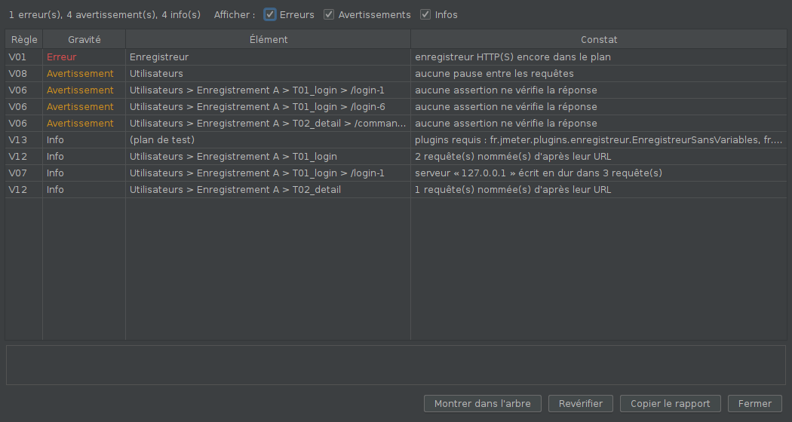

# Vérificateur de script

Signale les défauts courants d'un plan de test JMeter **avant de le livrer ou
de le lancer** : éléments de mise au point oubliés, chemins qui ne suivront
pas sur les injecteurs, groupe qui tourne sans fin, requêtes sans assertion,
plugins requis…

## Installation

Compatible JMeter 5.4.3 et plus récent, Java 11 (bytecode Java 8).

1. Fermer JMeter et copier `verificateur-script-0.1.0.jar` dans `lib\ext`.
2. Relancer JMeter.

Le plugin n'ajoute rien au plan : il ne fait que lire.

## Utilisation

Menu **Outils > Vérifier le plan…**. La fenêtre liste les constats, les
erreurs d'abord. Le bandeau donne le décompte.

- **Double-clic** sur une ligne, ou **Montrer dans l'arbre** : l'élément est
  sélectionné dans l'arbre de JMeter.
- Corriger dans l'arbre, puis **Revérifier** (la fenêtre reste ouverte).
- **Copier le rapport** : texte prêt à coller dans un ticket ou un courriel.
- Cases **Erreurs / Avertissements / Infos** : filtrer.

Les éléments désactivés (et tout ce qu'ils contiennent) sont ignorés.

## Règles

| Id | Gravité | Ce qui est signalé |
|---|---|---|
| V01 | Erreur | Enregistreur HTTP(S) encore dans le plan (inutile au tir ; l'enregistreur sans variables empêche d'ouvrir le plan sans son plugin) |
| V02 | Avertissement | Debug Sampler ou Debug PostProcessor actif |
| V03 | Avertissement | Récepteur gourmand actif : View Results Tree, View Results in Table, Arbre de résultats filtrable |
| V04 | Erreur | CSV Data Set sans fichier, ou avec un chemin absolu (ne suivra pas sur les injecteurs) |
| V05 | Avertissement | Groupe d'unités qui tourne sans fin (boucle infinie sans durée) |
| V06 | Avertissement | Requête HTTP sans assertion dans sa portée |
| V07 | Info | Serveur écrit en dur, par domaine, avec le nombre de requêtes |
| V08 | Avertissement | Groupe d'unités sans aucune minuterie (pas de temps de réflexion) |
| V09 | Info | Transaction sans « Generate parent sample » |
| V10 | Avertissement | Transaction vide |
| V11 | Avertissement | Plusieurs gestionnaires de cookies qui se superposent |
| V12 | Info | Requêtes nommées d'après leur URL (à renommer) |
| V13 | Info | Plugins requis : classes hors Apache JMeter utilisées par le plan, à installer sur les injecteurs |
| V14 | Avertissement | Gestionnaire d'en-têtes vide |

La portée suit les règles de JMeter : un élément s'applique aux requêtes de
son parent et de ses frères (V06, V08, V11).

## Fonctionnement

- `Regle` : une vérification ; `Regles.toutes()` les liste ; `Verificateur`
  les exécute (une règle qui plante n'arrête pas les autres) et trie.
- `Arbre` : parcours, portée JMeter, chemins lisibles.
- `MenuVerification` (interface `MenuCreator`) : JMeter le trouve seul.

## Essais

- `mvn test` : tests de chaque règle (cas positif et négatif).
- `../essais-scripting/lancer.sh` : essai commun aux plugins de scripting dans
  la vraie interface de JMeter (voir son en-tête).
